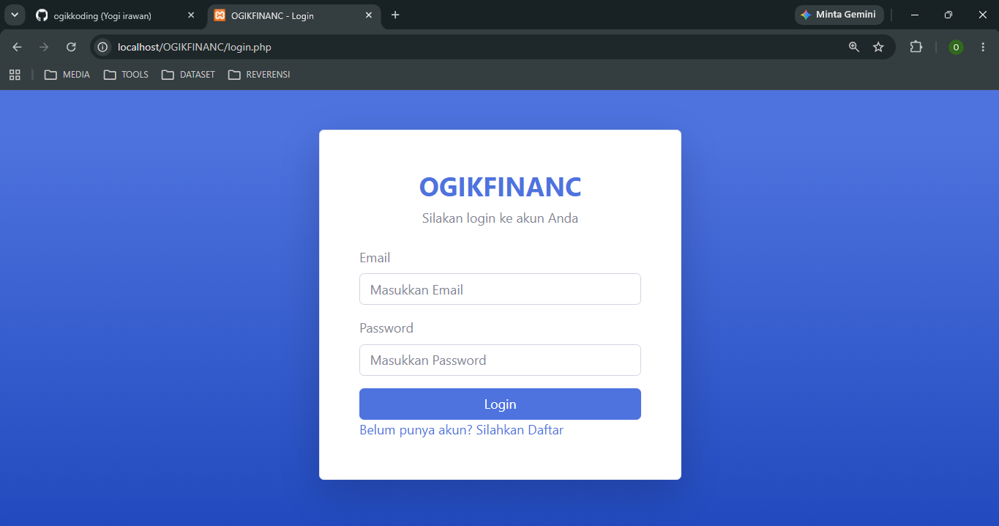
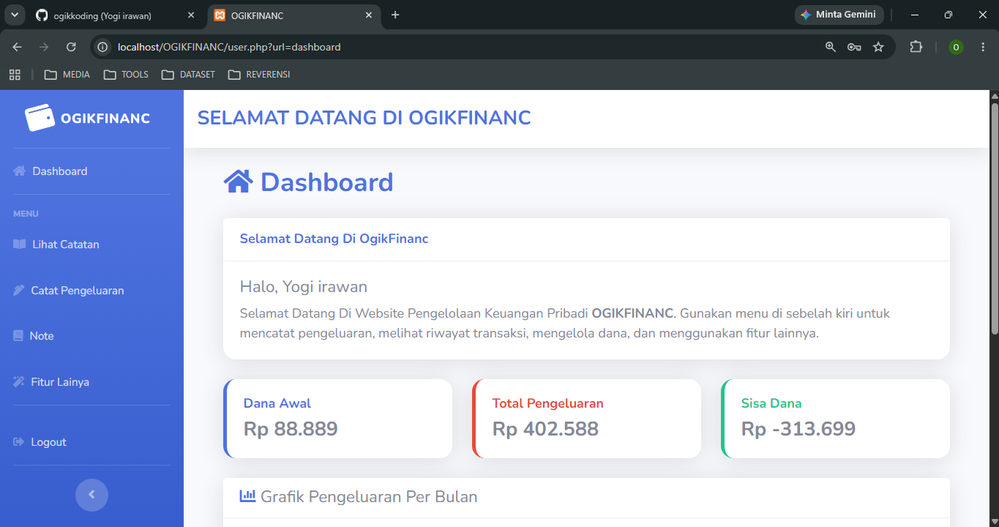
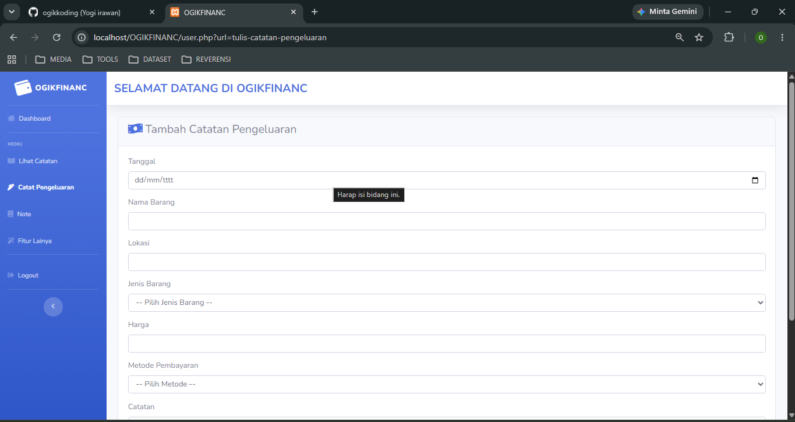
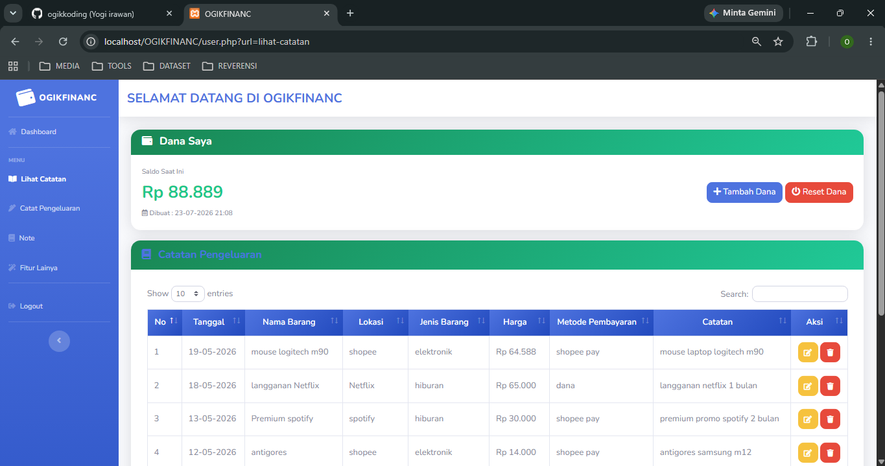
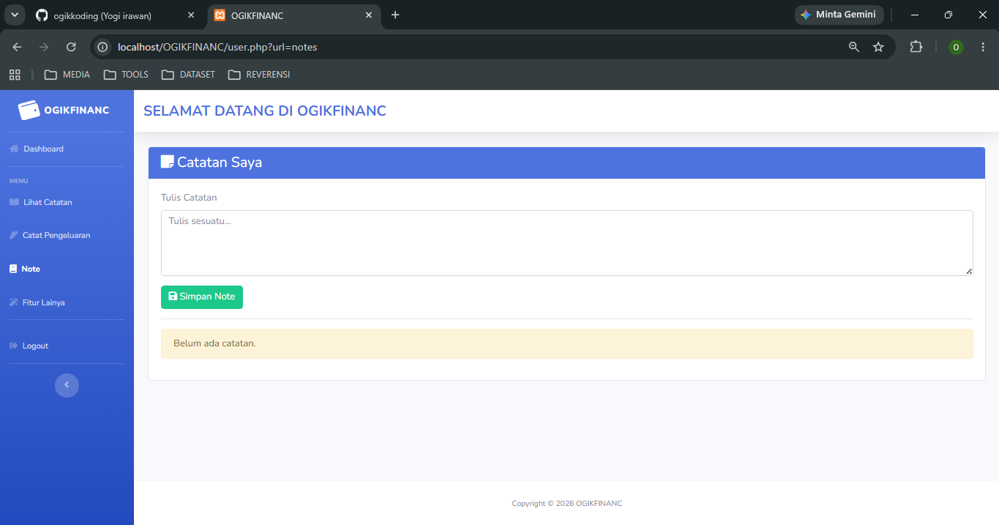
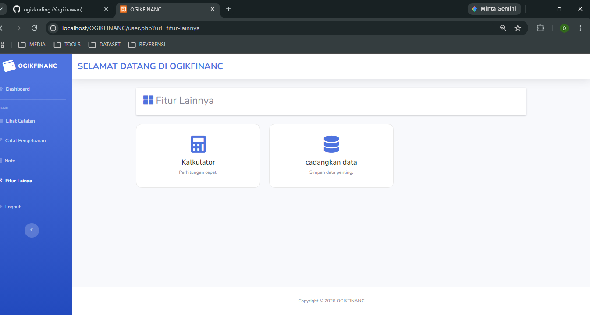

# 💰 OGIKFINANC

> Sistem Informasi Pengelolaan Anggaran Pengeluaran Pribadi Berbasis Web menggunakan PHP Native, Bootstrap 5, dan MySQL.


---

## 📖 Deskripsi

OGIKFINANC merupakan aplikasi berbasis web yang dirancang untuk membantu pengguna dalam mengelola anggaran pengeluaran pribadi.

Pengguna dapat menentukan dana awal sebagai anggaran, kemudian mencatat setiap transaksi pengeluaran. Setiap transaksi yang disimpan akan secara otomatis mengurangi saldo dana yang tersedia sehingga pengguna dapat memantau kondisi keuangan secara lebih mudah.

Selain pencatatan pengeluaran, aplikasi ini juga menyediakan grafik pengeluaran bulanan, catatan pribadi (Notes), kalkulator, pencadangan database, dan ekspor data ke Microsoft Excel.

---

## ✨ Fitur

- 🔐 Login & Register
- 📊 Dashboard
- 📉 Grafik Pengeluaran Bulanan
- 📝 Catat Pengeluaran
- 📝 Catat pemasukan
- 📋 Histori Pengeluaran
- 📋 Histori Pemasukan
- 📝 Notes
- 🧮 Kalkulator
- 💾 Backup Database dan Export Histori ke Microsoft Excel

---

## 🚀 Cara Kerja Sistem

1. Pengguna melakukan Login atau Register.
2. Menambahkan Dana Awal sebagai anggaran yang akan digunakan.
3. Mencatat setiap transaksi pengeluaran.
4. Sistem akan mengurangi saldo dana secara otomatis berdasarkan nominal pengeluaran.
5. Seluruh transaksi tersimpan ke database dan dapat dilihat pada halaman Histori Pengeluaran.
6. Dashboard menampilkan informasi dana saat ini dan grafik pengeluaran bulanan.
7. Pengguna dapat melakukan backup database maupun meng-export histori transaksi ke Microsoft Excel.

---

## 🛠️ Teknologi yang Digunakan

### Frontend

- HTML5
- CSS3
- Bootstrap 5
- JavaScript

### Backend

- PHP Native

### Database

- MySQL
- phpMyAdmin

### Library

- Chart.js
- Bootstrap Icons

### Tools

- Visual Studio Code
- XAMPP (Apache)
- Google Chrome

---

# 📂 Project Structure

```text
OGIKFINANC/
│
├── 📁 css/
├── 📁 database/
├── 📁 fitur_lainnya/
├── 📁 images/
├── 📁 js/
├── 📁 proses/
├── 📁 scss/
├── 📁 vendor/
│
├── 📄 dashboard.php
├── 📄 fitur_lainnya.php
├── 📄 lihat-catatan.php
├── 📄 login.php
├── 📄 logout.php
├── 📄 notes.php
├── 📄 register.php
├── 📄 tulis_catatan_pengeluaran.php
├── 📄 user.php
│
├── 📄 README.md
├── 📄 README.ID.md
└── 📄 LICENSE
```

---

# 🖼️ Pratinjau Aplikasi

## 🔐 Halaman Login

> Halaman autentikasi pengguna.



---

## 📊 Dashboard

> Menampilkan saldo saat ini, ringkasan keuangan, dan grafik pengeluaran bulanan.



---

## 💰 Manajemen Pengeluaran

> Antarmuka untuk mencatat transaksi pengeluaran harian.



---

## 📋 Riwayat Transaksi

> Menampilkan seluruh catatan transaksi keuangan.



---

## 📝 Catatan

> Fitur catatan pribadi untuk menyimpan informasi penting.



---

## ⚙️ Fitur Tambahan

> Kalkulator, cadangan basis data (database backup), dan ekspor Excel.



## ⚙️ Instalasi

### 1. Clone Repository

```bash
git clone https://github.com/username/OGIKFINANC.git
```

### 2. Pindahkan Project

```
htdocs/
```

### 3. Jalankan

- Apache
- MySQL

menggunakan XAMPP.

### 4. Import Database

Import file database yang berada pada folder

```
database/
```

menggunakan phpMyAdmin.

### 5. Jalankan Project

```
http://localhost/OGIKFINANC
```

---

## 📊 Fitur Dashboard

Dashboard menampilkan:

- Saldo Dana Saat Ini
- Grafik Pengeluaran Bulanan
- Informasi Pengeluaran

---

## 💾 Export & Backup

Aplikasi menyediakan fitur:

- Export histori pengeluaran ke Microsoft Excel.
- Backup database MySQL untuk menjaga keamanan data.

---

# 👨‍💻 Developer

## Yogi Irawan

**Undergraduate Student in Informatics Engineering**

### Areas of Interest

- Web Development
- Software Engineering
- Database Systems
- Artificial Intelligence
- Machine Learning

### Contact

📧 **Email**

yogiirawan490@gmail.com

💼 **LinkedIn**

https://www.linkedin.com/in/yogi-irawan-ab146a387

🐙 **GitHub**

https://github.com/ogikkoding

# 📄 License

This project is licensed under the **GNU General Public License v3.0 (GPL-3.0)**.

You are free to use, modify, and distribute this software under the terms of the GPL-3.0 License. Any derivative work must also be distributed under the same license.

See the [LICENSE](LICENSE) file for more details.

Copyright © 2026 **Yogi Irawan**
