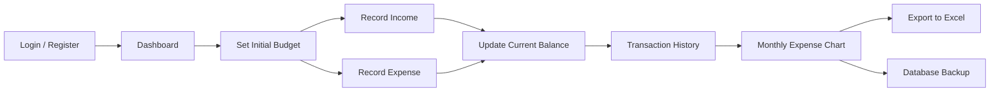

# 💰 OGIKFINANC

> A web-based personal finance management system developed using **PHP Native**, **Bootstrap 5**, **MySQL**, and **Chart.js**. The application helps users manage their personal budget, record financial transactions, monitor expenses, and visualize financial activities through an intuitive dashboard.


---

# 📖 Overview

OGIKFINANC is a web-based personal finance management application designed to help users organize and monitor their daily financial activities.

Users can set an initial budget, record income and expense transactions, and automatically track their remaining balance. Every expense transaction updates the available budget in real time, making it easier to monitor personal spending habits.

In addition to financial transaction management, the application provides monthly expense visualization, personal notes, a built-in calculator, database backup, and Microsoft Excel export functionality for better financial record management.

---

# ✨ Features

- 🔐 User Authentication (Login & Register)
- 📊 Interactive Dashboard
- 📉 Monthly Expense Analytics
- 💰 Income Management
- 📝 Expense Management
- 📋 Income History
- 📋 Expense History
- 📝 Personal Notes
- 🧮 Built-in Calculator
- 💾 Database Backup
- 📄 Export Transaction History to Microsoft Excel

---

# 🔄 System Workflow

The application operates through the following workflow:



The workflow begins when users log into the system and define their initial budget. Income and expense transactions are then recorded, and the current balance is automatically updated. Users can review their transaction history, monitor spending through graphical reports, export transaction data, and back up the database for data security.

---

# 🛠️ Technology Stack

## Frontend

- HTML5
- CSS3
- Bootstrap 5
- JavaScript

## Backend

- PHP Native

## Database

- MySQL
- phpMyAdmin

## Libraries

- Chart.js
- Bootstrap Icons

## Development Tools

- Visual Studio Code
- XAMPP (Apache)
- Google Chrome

---

# 📂 Project Structure

```text
OGIKFINANC/
│
├── 📁 css/
├── 📁 database/
├── 📁 fitur_lainnya/
├── 📁 images/
├── 📁 js/
├── 📁 proses/
├── 📁 scss/
├── 📁 vendor/
│
├── 📄 dashboard.php
├── 📄 fitur_lainnya.php
├── 📄 lihat-catatan.php
├── 📄 login.php
├── 📄 logout.php
├── 📄 notes.php
├── 📄 register.php
├── 📄 tulis_catatan_pengeluaran.php
├── 📄 user.php
│
├── 📄 README.md
├── 📄 README.ID.md
└── 📄 LICENSE
```

---

# 🖼️ Application Preview

## 🔐 Login Page

> User authentication page.

`images/login.png`

---

## 📊 Dashboard

> Displays the current balance, financial summary, and monthly expense chart.

`images/dashboard.png`

---

## 💰 Expense Management

> Interface for recording daily expense transactions.

`images/tulis_pengeluaran.png`

---

## 📋 Transaction History

> Displays all recorded financial transactions.

`images/lihat_catatan_pengeluaran.png`

---

## 📝 Notes

> Personal notes feature for recording important information.

`images/notes.png`

---

## ⚙️ Additional Features

> Calculator, database backup, and Excel export.

`images/fitur_lainnya.png`

---

# 🚀 Getting Started

## 1. Clone the Repository

```bash
git clone https://github.com/ogikkoding/OGIKFINANC.git
```

---

## 2. Move the Project

Copy the project folder into your XAMPP **htdocs** directory.

```text
htdocs/
```

---

## 3. Start the Server

Run the following services using XAMPP:

- Apache
- MySQL

---

## 4. Import the Database

Import the SQL file located in the **database** folder using phpMyAdmin.

---

## 5. Launch the Application

Open your web browser and navigate to:

```text
http://localhost/OGIKFINANC
```

---

# 📊 Dashboard Overview

The dashboard provides the following information:

- 💰 Current Balance
- 📉 Monthly Expense Chart
- 📋 Financial Summary

---

# 💾 Export & Backup

The application includes features for:

- 📄 Exporting transaction history to Microsoft Excel.
- 💾 Backing up the MySQL database for data security and recovery.

---

# 👨‍💻 Developer

## Yogi Irawan

**Undergraduate Student in Informatics Engineering**

### Areas of Interest

- Web Development
- Software Engineering
- Database Systems
- Artificial Intelligence
- Machine Learning

### Contact

📧 **Email**

yogiirawan490@gmail.com

💼 **LinkedIn**

https://www.linkedin.com/in/yogi-irawan-ab146a387

🐙 **GitHub**

https://github.com/ogikkoding

---

# 🤝 Contributing

Contributions are welcome!

If you discover bugs, have suggestions for improvements, or would like to contribute new features, please feel free to:

- Open an Issue
- Submit a Pull Request

---

# ⭐ Support

If you find this project useful, please consider giving it a ⭐ on GitHub.

Your support helps encourage future development and continuous improvement.

---

# 📄 License

This project is licensed under the **GNU General Public License v3.0 (GPL-3.0)**.

You are free to use, modify, and distribute this software under the terms of the GPL-3.0 License. Any derivative work must also be distributed under the same license.

See the **LICENSE** file for more details.

Copyright © 2026 **Yogi Irawan**
